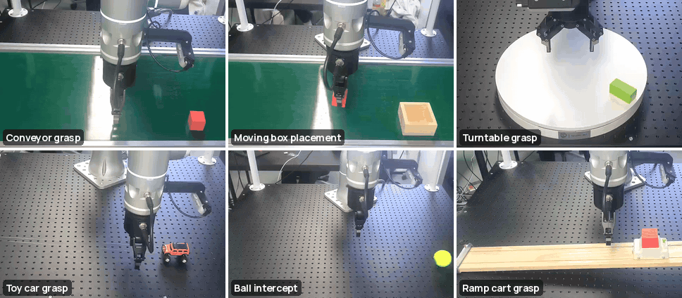
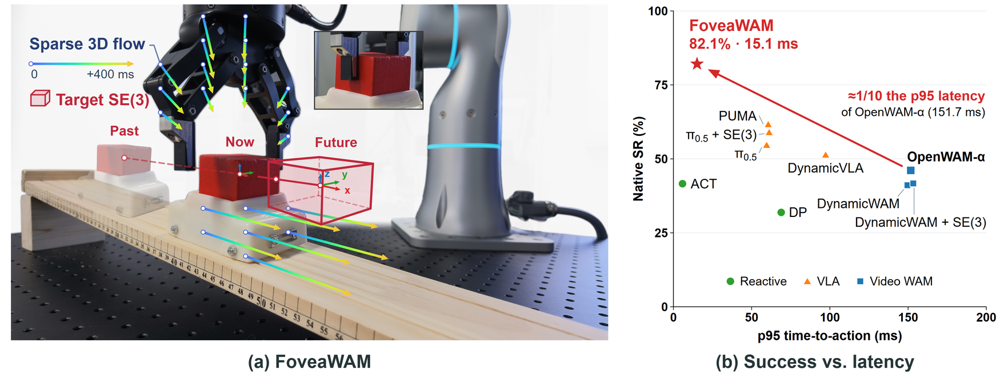
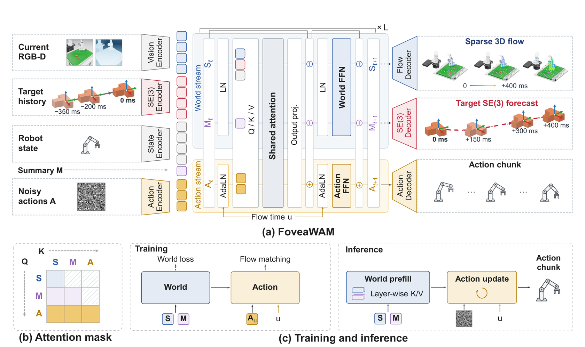

<p align="center">
  <picture>
    <source media="(prefers-color-scheme: dark)" srcset="media/logo-dark.png">
    
  </picture>
</p>

<p align="center"><b>Role-Aware 4D World–Action Modeling for Dynamic Manipulation</b></p>

<p align="center">
  Jiaqi Yin<sup>1,2</sup>&nbsp;&nbsp;
  Baoyue Zhang<sup>2</sup>&nbsp;&nbsp;
  Jiyuan Zhang<sup>3</sup>&nbsp;&nbsp;
  Wenxuan Liu<sup>2</sup>&nbsp;&nbsp;
  Zhaofei Yu<sup>2</sup>&nbsp;&nbsp;
  Yue Deng<sup>1,†</sup>&nbsp;&nbsp;
  Tiejun Huang<sup>2,†</sup>
  <br>
  <sup>1</sup>Beijing Zhongguancun Academy&nbsp;&nbsp;
  <sup>2</sup>Peking University&nbsp;&nbsp;
  <sup>3</sup>Beijing Academy of Artificial Intelligence
  <br>
  <sup>†</sup>Corresponding authors
</p>

<p align="center">
  <a href="https://foveawam.github.io"></a>
  <a href="https://arxiv.org/abs/XXXX.XXXXX"></a>
  <a href="https://huggingface.co/JiaqiYin"></a>
</p>

<p align="center">
  
  <br>
  <i>FoveaWAM on six real-robot tasks with moving objects.</i>
</p>

## Overview

To manipulate a moving object, a policy has to predict the scene at the moment its action executes, and every millisecond spent predicting pushes that moment further away. FoveaWAM is a 4D world–action model that spends its precision where contact happens, much as the eye spends it in the fovea. It predicts the target's motion as a metric SE(3) trajectory, the surroundings as sparse 3D flow, and takes everything static from the current frame.

This compact representation lets FoveaWAM act in 15.1 ms on one RTX 5090, about 10× faster than video world–action models. On [OnTimeBench](https://github.com/ArrebolBlack/OnTimeBench), where the scene keeps moving while the policy computes, it reaches 82.1% success against 61.4% for the strongest baseline. It also leads on DOMINO and on our real-robot tasks.



*Left: the two motion representations on a staged grasp. Right: success on the 1,400 OnTimeBench test scenes at each policy's measured latency.*

## News

- **[2026/11]** We release the code, the simulation checkpoint and the OnTimeBench training data.

## Installation

FoveaWAM needs Linux, Python 3.12, PyTorch ≥ 2.11 with CUDA, and a GPU that supports BF16.

```bash
conda create -n foveawam python=3.12 -y
conda activate foveawam

git clone https://github.com/ArrebolBlack/FoveaWAM.git
cd FoveaWAM
pip install -e .                  # or -e ".[ontimebench]" to also evaluate on OnTimeBench
```

## Quick Start

Download the simulation checkpoint and one Harmonic grasp episode, then predict an action chunk from the first eight observations:

```bash
pip install "huggingface_hub>=0.34"
hf download JiaqiYin/FoveaWAM foveawam-ontimebench.pt --local-dir weights
hf download JiaqiYin/OnTimeBench episodes/harmonic_grasp/000000.hdf5 --repo-type dataset --local-dir data

python -m foveawam.cli.infer --bundle weights/foveawam-ontimebench.pt \
  --episode data/episodes/harmonic_grasp/000000.hdf5 --output prediction.npz
```

The first call compiles the BF16 policy. `prediction.npz` contains `actions_e7`, an `(8, 7)` array. Each row is a translation increment in metres, a rotation increment as a rotation vector in radians and a discrete gripper command, all in the robot base frame.

To run the policy in your own control loop:

```python
from foveawam.api import load_policy

policy = load_policy("weights/foveawam-ontimebench.pt", compile_model=True)
policy.reset("harmonic_grasp")              # at the start of every episode

# Feed every 20 Hz tick exactly once as a foveawam.api.PolicyObservation.
policy.observe(obs)                         # ticks between queries
chunk = policy.predict_action_chunk(obs)    # the query tick
chunk.actions                               # (8, 7) float32 tensor on the CPU
```

Besides the RGB-D view and the robot state, an observation includes the target pose (`target_position_m`, `target_quaternion_xyzw`), taken from the simulator on OnTimeBench or from a pose tracker on a real robot. See [`policy.py`](src/foveawam/inference/policy.py) for all fields and units. To also get the predicted target trajectory and scene flow, call `policy.predict_motion(obs)` instead.

<details>
<summary>How the policy generates an action chunk</summary>



The world stream reads one calibrated RGB-D view and eight ticks of target pose and robot state. During training, the scene tokens predict sparse 3D flow and the summary tokens predict the target trajectory. At inference, the action stream reuses the world stream's keys and values across five flow-matching steps. The model is defined in [`models/model.py`](src/foveawam/models/model.py).

</details>

## Evaluation on OnTimeBench

| Checkpoint | Native SR | +150 ms SR | Paused SR | p95 query time |
| --- | ---: | ---: | ---: | ---: |
| `foveawam-ontimebench.pt` | 82.1% | 34.1% | 90.3% | 15.1 ms |

Success rates are means over the 14 tasks, with 100 held-out scenes per task. FoveaWAM reads the target pose from the simulator. Query time was measured at batch size one on an RTX 5090 and excludes pose tracking. Baseline results are in the [OnTimeBench README](https://github.com/ArrebolBlack/OnTimeBench#results).

To run the first held-out Harmonic grasp scene (on headless Linux, `export MUJOCO_GL=egl` first):

```bash
python -m foveawam.cli.evaluate --bundle weights/foveawam-ontimebench.pt \
  --protocol native --shard-index 0 --shard-count 1400 --output harmonic_grasp-native.json
```

Omit both shard flags to run the full suite. By default, the evaluator replays the RTX 5090 timings from the paper ([`latency_rtx5090.json`](src/foveawam/configs/latency_rtx5090.json)). To evaluate at your own GPU's latency, measure a profile and pass it with `--latency-profile`:

```bash
python -m foveawam.cli.latency --bundle weights/foveawam-ontimebench.pt \
  --episode data/episodes/harmonic_grasp/000000.hdf5 --output latency.json
```

## Training

The [ten-epoch configuration](src/foveawam/configs/foveawam_train10.yaml) trains on all 11,200 OnTimeBench demonstrations. It follows the learning-rate schedule of the released checkpoint and stops after 25,870 optimizer steps at a global batch size of 512.

<details>
<summary>Download the data and launch training</summary>

Set `DATA` to a shared directory with room for the dataset (about 347 GB), `MAE` to the pretrained [MAE ViT-B/16 checkpoint](https://github.com/facebookresearch/mae#fine-tuning-with-pre-trained-checkpoints) and `DINO` to the [DINOv3 ViT-L/16](https://huggingface.co/facebook/dinov3-vitl16-pretrain-lvd1689m) `model.safetensors` file. MAE is the frozen image encoder; DINOv3 provides visual targets during training only.

```bash
hf download JiaqiYin/OnTimeBench --repo-type dataset --local-dir "$DATA"
```

Run the following on each of two eight-GPU nodes. Set `MASTER_ADDR` to the address of the first node, `NODE_RANK` to 0 or 1, and `RUN` to a shared directory for checkpoints.

```bash
torchrun --nnodes=2 --nproc-per-node=8 --node-rank="$NODE_RANK" \
  --master-addr="$MASTER_ADDR" --master-port=29500 -m foveawam.cli.train \
  --config-name foveawam_train10 data.root="$DATA" \
  perception.vision.weights_path="$MAE" model.future_dino_teacher_weights_path="$DINO" \
  training.output_dir="$RUN"
```

Export the trained checkpoint, together with its action normalization, into a policy bundle:

```bash
python -m foveawam.cli.export --checkpoint "$RUN/latest.pt" --output foveawam-retrained.pt
```

</details>

## Repository Layout

```
src/foveawam/
├── models/       world and action streams, prediction heads (model.py)
├── perception/   frozen MAE encoder, depth back-projection, training targets
├── objectives/   flow-matching action loss and world-prediction losses
├── data/         OnTimeBench episode reader, observation windows, normalization
├── training/     training loop, checkpoints, distributed setup
├── inference/    bundle loading, policy state and the five-step sampler
├── evaluation/   OnTimeBench adapter
├── configs/      training configuration and reference latency profile
└── cli/          infer, latency, evaluate, train, cache_teacher, export
```

## Acknowledgements

We use the frozen [MAE](https://github.com/facebookresearch/mae) encoder and take training targets from [DINOv3](https://github.com/facebookresearch/dinov3). OnTimeBench is built on [MuJoCo](https://github.com/google-deepmind/mujoco) and [robosuite](https://github.com/ARISE-Initiative/robosuite). Many thanks to their authors for open-sourcing them.

## Citation

```bibtex
@misc{yin2026foveawam,
  title  = {{FoveaWAM}: Role-Aware {4D} World--Action Modeling for Dynamic Manipulation},
  author = {Yin, Jiaqi and Zhang, Baoyue and Zhang, Jiyuan and Liu, Wenxuan and
            Yu, Zhaofei and Deng, Yue and Huang, Tiejun},
  year   = {2026},
  url    = {https://foveawam.github.io}
}
```

## License

The code is released under [Apache 2.0](LICENSE). The [model weights](MODEL_LICENSE.md) are released for non-commercial research and evaluation, and the MAE encoder inside them keeps its CC BY-NC 4.0 license. The reference timings in [`latency_rtx5090.json`](src/foveawam/configs/latency_rtx5090.json) are released under [CC BY 4.0](https://creativecommons.org/licenses/by/4.0/). See the [third-party notices](THIRD_PARTY_NOTICES.md) for upstream terms.
